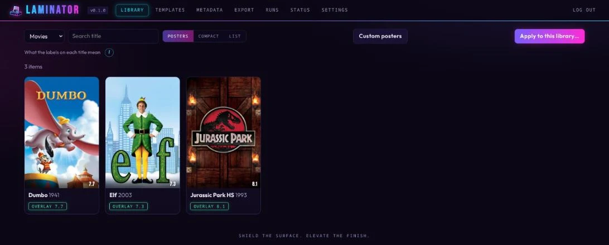
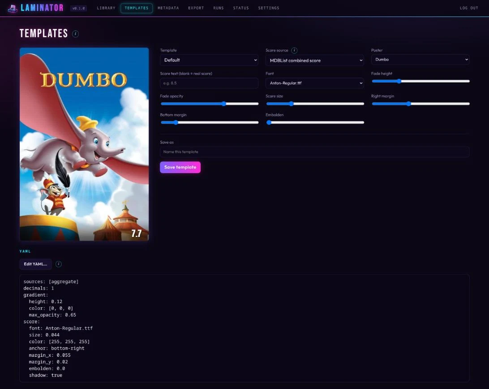
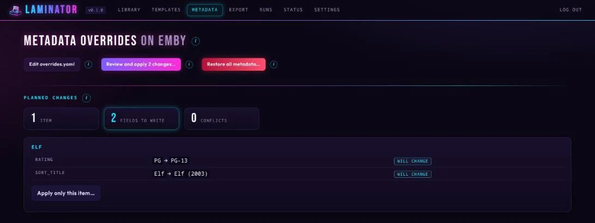

<h1 align="center"></h1>

<p align="center">
  <a href="https://hub.docker.com/r/cj0r/laminator"></a>
  <a href="https://hub.docker.com/r/cj0r/laminator"></a>
  <a href="https://hub.docker.com/r/cj0r/laminator"></a>
  <a href="https://github.com/cj0r/laminator/actions/workflows/tests.yml"></a>
  <a href="LICENSE"></a>
</p>

Score badges and metadata overrides for **Emby and Jellyfin**.

laminator draws a rating from MDBList onto your movie and show posters and lets you correct metadata such as content ratings, titles and tags, all from a web UI. Everything it changes can be put back.



> [!WARNING]
> laminator changes posters and metadata on your media server. Try it on a few titles first, and read the [disclaimer](#disclaimer).

## Features

- **Score badges** from MDBList (combined score, or IMDb, TMDb, Rotten Tomatoes and others), always drawn on the untouched original, so they update instead of stacking.
- **Templates** with a live preview, to design the badge.
- **Metadata overrides**: content rating, title, sort title, tagline, critic rating, tags, genres and more, locked so a refresh can't undo them.
- **Custom posters** per title, for fan edits and the like.
- **Fully reversible**: originals and old values are kept, per title or all at once.
- Scheduled runs, backups, two-factor sign-in, and Emby and Jellyfin side by side.

## Quick start

```yaml
services:
  laminator:
    image: cj0r/laminator:latest
    restart: unless-stopped
    ports: ["5264:5264"]
    volumes:
      - ./data:/data
```

The image is [`cj0r/laminator` on Docker Hub](https://hub.docker.com/r/cj0r/laminator) (`linux/amd64` and `linux/arm64`; tags `latest`, `0`, `0.2` and exact versions such as `0.2.2`), also on `ghcr.io/cj0r/laminator`.

Run `docker compose up -d`, open `http://<host>:5264`, and choose your password (the setup code is in `docker logs laminator`). Then add your server and MDBList key in **Settings**. Unraid and other setups are in [Getting started](docs/getting-started.md).

## Screenshots

| | |
|---|---|
|  |  |
| **Templates**: design the badge on a real poster. | **Metadata**: see every change before it's written. |

## User guide

[Getting started](docs/getting-started.md) · [Web UI](docs/web-ui.md) · [Posters](docs/posters.md) · [Templates](docs/templates.md) · [Custom posters](docs/custom-posters.md) · [Metadata overrides](docs/metadata-overrides.md) · [Export](docs/export.md) · [Backups](docs/backups.md) · [Maintenance](docs/maintenance.md) · [Settings](docs/settings.md) · [Upgrading](docs/upgrading.md) · [Command line](docs/command-line.md) · [Security](docs/security.md) · [Troubleshooting](docs/troubleshooting.md)

## Disclaimer

laminator is provided **as is, without warranty**, and you use it at your own risk. The authors accept no liability for changed posters or metadata, lost data or any other damage.

- It **changes your media server**: posters, and metadata fields it locks. Keep backups of your server and of laminator's data folder.
- It was **developed with an AI coding assistant** (Claude Code) and tested against real Emby 4.10 and Jellyfin 10.11 servers. Jellyfin has been checked with movies (posters, metadata, restore); TV shows are less tested there. Treat it like any young project.
- Securing your deployment, and following the terms of the services you connect, is up to you. laminator is not affiliated with Emby, Jellyfin or MDBList.

## License

laminator is free software under the [GNU General Public License v3.0](LICENSE). Bundled fonts (SIL Open Font License) and dependency licenses are listed in [THIRD_PARTY_NOTICES.md](THIRD_PARTY_NOTICES.md).

## Support

If laminator is useful to you, you can support its development:

<p>
  <a href="https://ko-fi.com/cj000r"></a>
  <a href="https://www.buymeacoffee.com/cj0r"></a>
</p>

Bug reports and pull requests are welcome.
